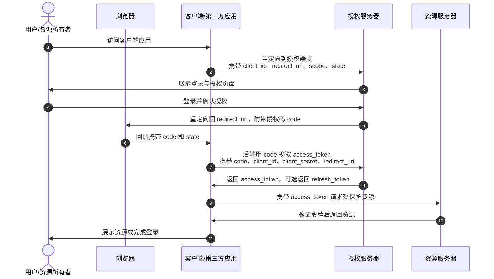

**OAuth 2.0（Open Authorization 2.0）**是一套**授权协议**，用来让第三方应用在**不拿到用户密码**的前提下，代表用户有限访问某个服务上的资源。它解决的问题是：如果想让一个应用读取用户在另一个平台上的数据资源，用户不应该把自己的账号密码交给它；而是应该通过一个授权流程，给它一个**有时效、有范围、可撤销**的访问令牌。

举个例子，某款游戏在使用QQ登录时需要获取QQ头像、名字以及好友关系，需要获得用户的授权。不正确的做法是：用户将自己的QQ账号和密码发给了游戏服务端，然后游戏使用这个账号密码登录QQ获取相关资源的授权。那么我们有没有什么办法，在不传输自己的账号密码情况下，也能使得游戏访问QQ中相关的有限的资源呢——这就是OAuth协议的初衷。


## 1.OAuth 2.0中的四个核心角色

OAuth 2.0 的四个核心角色分别承担“拥有资源、发起请求、发放令牌、校验令牌”的职责：

| 角色       | 作用                     |
| ---------- | ------------------------ |
| 资源所有者 | 拥有受保护资源的人       |
| 客户端     | 请求访问资源的第三方应用 |
| 授权服务器 | 验证用户并发放令牌       |
| 资源服务器 | 存放受保护资源           |

- **资源所有者**通常是用户，也就是受保护资源的真正拥有者，是决定是否允许某个第三方应用访问自己的资源信息的人。
- **客户端**是“代表”资源所有者发起请求的第三方应用，比如上述所说的游戏APP。它本身不拥有用户数据，只是“代为访问”。客户端需要先向授权服务器注册，获得 `client_id`、 `client_secret`，然后通过授权流程获取访问令牌。
- **授权服务器**是整个 OAuth 2.0 流程的信任中心，比如QQ授权服务器，它负责验证资源所有者的身份，确认用户是否同意授权，并根据授权结果向客户端发放访问令牌和可选的刷新令牌。
- **资源服务器**存放受保护资源，比如存储着QQ个人信息的资源服务器。它不直接验证用户账号密码，而是验证客户端带来的访问令牌是否有效、是否未过期、是否具备对应权限。如果令牌合法，就返回资源。

它们之间的关系是这样的：**资源所有者**把访问权限委托给**客户端**；**授权服务器**审核这次委托，并发放令牌；**客户端**拿着令牌去访问**资源服务器**；**资源服务器**校验令牌，据此决定是否返回数据。授权服务器和资源服务器在物理部署上可能属于同一套服务器，但在协议设计上须视为两个不同的角色。

## 2.OAuth 2.0标准授权码流程

常见的授权模式有**授权码模式**（Authorization Code Grant）、隐式授权模式、密码模式、客户端授权模式四种。由于后面三种一般只适用于受信任的场景，所以本文不再介绍，而着重介绍授权码模式。详细的流程如下：

### 第一步：客户端发起授权请求

用户在客户端应用里点击“授权登录”后，客户端会把用户的浏览器**重定向**到**授权服务器**的授权页面，比如 `/authorize`。

这个请求是一个 **GET 请求**，参数通过 URL 查询字符串传递，例如：

```http
GET /authorize?
  response_type=code
  &client_id=s6BhdRkqt3
  &redirect_uri=https%3A%2F%2Fclient.example.com%2Fcallback
  &scope=read%20profile
  &state=xyz
HTTP/1.1
Host: authorization-server.example.com
```

这里几个关键参数的传递方式是：

- **`response_type=code`**：告诉授权服务器这次请求要的是授权码。
- **`client_id`**：客户端注册时获得的唯一标识，用来告诉授权服务器“是谁在请求授权”。
- **`redirect_uri`**：用户授权完成后，授权服务器要把浏览器重定向回哪里，即重定向地址。
- **`scope`**：表示客户端希望申请哪些权限，比如只读、获取头像、获取邮箱等。
- **`state`**：客户端生成的随机值，授权服务器会原样带回，防止 CSRF 攻击。

### 第二步：用户登录并授权

授权服务器收到请求后，会先校验 `client_id`、`redirect_uri`、`scope` 是否合法。

如果用户未登录，就让用户登录；如果用户已登录，就展示授权页面，告诉用户“某某应用希望访问你的哪些资源”。用户同意后，授权服务器就生成一个短期有效的 **授权码 `code`**。

### 第三步：授权服务器回调客户端

授权服务器通过 **重定向** 把用户浏览器带回客户端的 `redirect_uri`，并在 URL 查询参数中附带 `code` 和 `state`：

```http
HTTP/1.1 302 Found
Location: https://client.example.com/callback?code=SplxlOBeZQQYbYS6WxSbIA&state=xyz
```

- **`code`** 只在 URL 中出现一次，有效期很短，通常只能使用一次。
- **`state`** 必须和第一步中客户端发出的值完全一致，客户端收到后要进行校验。

### 第四步：客户端后端换取访问令牌

客户端后端拿到 `code` 后，会向**授权服务器**的令牌端点 `/token` 发起 **POST 请求**，用授权码换取访问令牌。

这个请求通常使用 `application/x-www-form-urlencoded` 格式传递参数：

```http
POST /token HTTP/1.1
Host: authorization-server.example.com
Content-Type: application/x-www-form-urlencoded

grant_type=authorization_code
&code=SplxlOBeZQQYbYS6WxSbIA
&redirect_uri=https%3A%2F%2Fclient.example.com%2Fcallback
&client_id=s6BhdRkqt3
&client_secret=CLIENT_SECRET
```

- **`grant_type=authorization_code`**：固定值，表示使用授权码模式。
- **`code`**：上一步从回调 URL 中拿到的授权码。
- **`redirect_uri`**：必须和第一步授权请求中的 `redirect_uri` 完全一致，用于防止授权码被劫持后滥用。
- **`client_id`**：再次标识客户端身份。
- **`client_secret`**：客户端密钥，只能由**客户端后端**发送给授权服务器，不能暴露给浏览器或前端。

### 第五步：授权服务器返回令牌

授权服务器验证授权码、`client_secret`、`redirect_uri`、`client_id` 都正确后，会返回 JSON 响应：

```json
{
  "access_token": "ACCESS_TOKEN",
  "token_type": "Bearer",
  "expires_in": 3600,
  "refresh_token": "REFRESH_TOKEN",
  "scope": "read profile"
}
```

其中：

- **`access_token`**：访问令牌，用于访问资源服务器。
- **`token_type`**：通常是 `Bearer`，表示持有该令牌即可访问资源。
- **`expires_in`**：令牌有效期。
- **`refresh_token`**：可选，用于在访问令牌过期后换取新的访问令牌。
- **`scope`**：最终授予的**权限范围**，可能小于或等于请求的 `scope`。

### 第六步：客户端访问资源服务器

客户端拿到 `access_token` 后，就可以访问资源服务器。通常把**令牌**放在 HTTP 请求头中：

```http
GET /api/user/profile HTTP/1.1
Host: resource-server.example.com
Authorization: Bearer ACCESS_TOKEN
```

资源服务器验证令牌有效、未过期、权限范围匹配后，就会返回受保护资源。





## 3.授权码流程的常见攻击场景

### （1）授权码拦截：偷走授权码 code以换取 access_token

授权码拦截攻击发生在授权服务器把 `code` 通过浏览器重定向返回给客户端的过程中。**攻击者在授权码从授权服务器返回客户端的链路中把它截获，然后冒充合法客户端，用这个授权码换取访问令牌**。它之所以能成立，是因为授权码会经过浏览器进行传递，而很多客户端尤其是移动 App、单页应用这类公共客户端，又无法可靠保存 `client_secret`。

正常情况下：

```text
授权服务器 → 浏览器 → 客户端 callback
URL: https://client.example.com/callback?code=ABC
```

但 `code` 出现在 URL 里，如果传输链路或回调环节不安全，攻击者就可能截获它。一旦攻击者拿到 `code`，就可能向 `/token` 接口发起请求：

```http
POST /token
code=STOLEN_CODE
&client_id=xxx
&client_secret=xxx
&redirect_uri=https://client.example.com/callback
&grant_type=authorization_code
```

如果客户端是**公共客户端**，比如移动 App等，本身没有可靠的 `client_secret`，也没有启用 PKCE，授权服务器可能仅凭 `code` 就签发 `access_token`。用户明明没有把账号交给攻击者，但攻击者通过拦截授权码，间接拿到了访问用户资源的令牌。

### （2）用攻击者的 code绑定到受害者账户

这种“狸猫换太子”的攻击与CSRF类似。它的核心是让客户端**把攻击者的第三方身份错误绑定到受害者账户上**。

典型流程是：

1. 攻击者先用自己的账号完成 OAuth 授权，得到一个合法的 `code`。
2. 攻击者不让自己完成回调，而是把这个带 `code` 的回调链接发给受害者。
3. 假设受害者已经登录客户端系统，点击链接后，浏览器带着受害者的登录状态访问 `callback?code=攻击者的code`。
4. 客户端如果没有校验 `state`，就无法判断这次回调到底是不是受害者自己发起的。
5. 客户端用这个 `code` 换取 `access_token`，发现是攻击者的第三方账号。
6. 客户端把这个第三方账号**绑定**到受害者的本地账户。
7. 之后攻击者再用同一个第三方账号登录，就能直接进入受害者账户。


> 为什么这种攻击能够成立呢？

它们共同利用了授权码流程里的几个薄弱点：

- **`code` 经过浏览器传递**，容易被拦截或泄露。
- **`redirect_uri` 未精确校验**，授权码可能流向攻击者控制的地址。
- **`state` 未生成或未校验**，客户端无法确认回调是否来自自己发起的请求。

前者可以靠 PKCE、HTTPS、redirect_uri 校验来防；后者主要靠 `state` 与会话绑定进行防御。


## 4.授权码的防御——PKCE

在标准授权码流程中，正如上面小节里提到的授权码拦截，公共客户端无法安全存储 `client_secret`，因此授权服务器难以区分请求来自合法客户端还是恶意客户端， 由于没有`client_secret`验证，攻击者可能成功换取令牌。PKCE 正是为了解决这个问题而设计。

PKCE（Proof Key for Code Exchange，RFC 7636）是 OAuth 2.0 授权码流程的安全扩展，核心作用是**防止公共客户端（如移动 App、桌面应用）的授权码被拦截后冒用**。 它通过“先承诺、后揭示”的机制，让客户端在不依赖 `client_secret` 的前提下，证明换`token`的人就是最初发起授权的人。

### PKCE的三个核心参数

| 参数                    | 含义       | 说明                                              |
| ----------------------- | ---------- | ------------------------------------------------- |
| `code_verifier`         | 代码验证器 | 客户端**本地**生成的随机字符串，43–128 字符       |
| `code_challenge`        | 代码质询   | 由 `code_verifier` 经变换算法得到，随授权请求发送 |
| `code_challenge_method` | 变换算法   | 变换算法，取值为 `S256` 或 `plain`（已较少使用）  |

`code_verifier` 须使用密码学安全随机数生成器（CSPRNG）来生成。

### 完整工作流程

**步骤 1：客户端生成本地凭证：** 客户端随机生成 `code_verifier`，并用 S256 算法计算 `code_challenge`。`code_verifier` 保存在客户端本地，不对外发送。

**步骤 2：发起授权请求** 客户端将用户重定向到授权服务器的 `/authorize` 端点，除常规参数外还额外携带：

```
  &code_challenge=E9Melhoa2OwvFrEMTJguCHaoeK1t8URWbuGJSstw-cM
  &code_challenge_method=S256
```

**步骤 3：用户授权，返回授权码** 用户完成认证和授权后，授权服务器通过 `redirect_uri` 将授权码 `code` 返回给客户端。

**步骤 4：用授权码换取令牌** 客户端向 `/token` 端点发起 POST 请求，携带授权码和原始 `code_verifier`：

```
POST /token
grant_type=authorization_code
&code=SplxlOBeZQQYbYS6WxSbIA
&redirect_uri=xxx
&client_id=xxx
&code_verifier=dBjftJeZ4CVP-mB92K27uhbUJU1p1r_wW1gFWFOEjXk
```

这是客户端后端与 Token 端点对`code_verifier`，不会经过浏览器重定向，攻击者无法获取。

**步骤 5：授权服务器验证并颁发令牌** 授权服务器根据存储的 `code_challenge_method` 对收到的 `code_verifier` 做相同变换，将结果与之前存储的 `code_challenge` 比对。匹配则颁发 Access Token，不匹配则拒绝请求并使授权码失效。


> PKCE的安全原理是：授权服务器要同时验证`code`和`code_verifier`通过后才会颁发Token。由于`code_verifier`是由客户端随机生成且使用哈希函数SHA-256进行哈希，而又在客户端后端进行传输，攻击者无法截获`code_verifier`，也无法从 `code_challenge` 反推 `code_verifier`。即使截获了`code`也无法通过授权服务器的验证。

PKCE 最初为公共客户端设计，但因其显著的安全优势，**OAuth 2.1 已将其作为所有授权码流程的强制要求**，机密客户端（Confidential Client）同样建议使用。 许多主流身份提供商均已支持或强制 PKCE。

## 参考文献

1. IETF, [RFC 6749: The OAuth 2.0 Authorization Framework](https://www.rfc-editor.org/rfc/rfc6749)
2. IETF, [RFC 7636: Proof Key for Code Exchange by OAuth Public Clients](https://www.rfc-editor.org/rfc/rfc7636)
